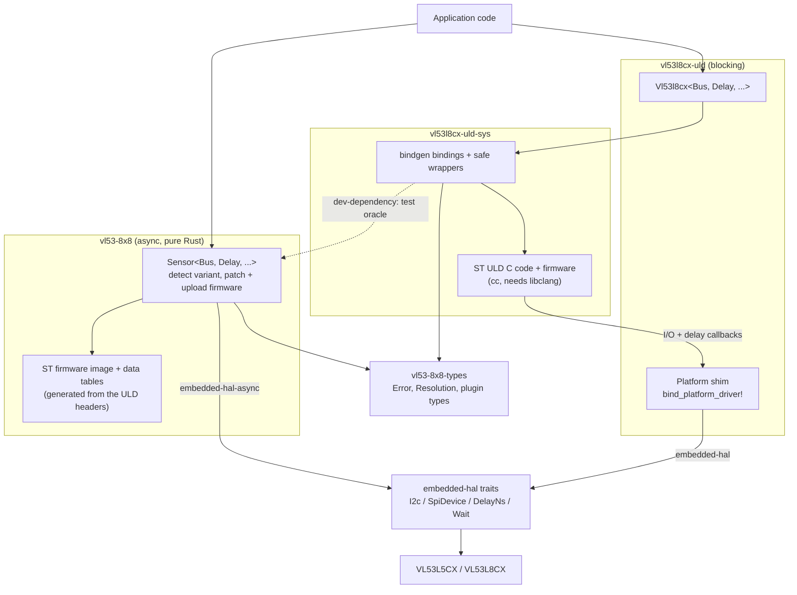

# VL53L5CX / VL53L8CX Drivers (Rust)

[](LICENSE)
[](https://marketplace.visualstudio.com/items?itemName=bierner.markdown-mermaid)

Platform-agnostic Rust drivers for the **STMicroelectronics VL53L5CX and
VL53L8CX** 8×8 multizone Time-of-Flight (ToF) ranging sensors, built on
`embedded-hal` 1.0.

Two drivers share one set of types:

- **`vl53-8x8`** — pure Rust, async, no C toolchain. Autodetects whether a
  VL53L5CX or a VL53L8CX is connected and uploads one shared firmware image
  patched per variant (the two differ by only a few bytes).
- **`vl53l8cx-uld`** — blocking, wraps ST's official Ultra Lite Driver (ULD)
  C code via `vl53l8cx-uld-sys`. VL53L8CX only; needs libclang to build.

## Crates

| Crate / directory          | Role                                                                    |
| -------------------------- | ----------------------------------------------------------------------- |
| [`vl53-8x8-types`](./vl53-8x8-types) | Shared enums, `Error`, plugin types. `no_std`, zero dependencies.       |
| [`vl53-8x8`](./vl53-8x8)             | Pure-Rust async driver for VL53L5CX + VL53L8CX (`embedded-hal-async`).  |
| [`vl53l8cx-uld-sys`](./vl53l8cx-uld-sys) | bindgen + `cc` over ST's VL53L8CX ULD C sources and firmware.          |
| [`vl53l8cx-uld`](./vl53l8cx-uld)     | Safe blocking `embedded-hal` wrapper over `vl53l8cx-uld-sys`.           |
| [`vl53l5cx-uld-sys`](./vl53l5cx-uld-sys) | ST's VL53L5CX ULD, compiled the same way. **Unpublished** test oracle: lets `vl53-8x8` check its L5 firmware/config patches against ST's L5 arrays byte for byte. |
| [`nucleo-f401re/`](./nucleo-f401re)  | Demo: blocking (`vl53l8cx-uld`) on STM32F401RE Nucleo + X-NUCLEO-53L8A1, I²C or SPI (`spi-bus`). |
| [`nucleo-f401re-async/`](./nucleo-f401re-async) | Demo: async (`vl53-8x8`, Embassy) on the same board.           |
| [`evo-f412re-async/`](./evo-f412re-async) | Demo: async (`vl53-8x8`) on a custom STM32F412RE board, DMA I²C, L5 or L8, two sensors on one bus. |
| [`rpi-zero-2w/`](./rpi-zero-2w)      | Demo: Linux on Raspberry Pi Zero 2W, both drivers, SPI via `linux-embedded-hal`. |

The demo crates are `publish = false` and are standalone workspace roots, so
each is built from its own directory.

## Verified platforms

These are the configurations actively built and run against real hardware in
this repository:

* **Bare-metal Cortex-M4** — STM32F401RE Nucleo board with the
  X-NUCLEO-53L8A1 expansion shield, both I²C and SPI, both blocking
  (`stm32f4xx-hal`) and async (`embassy-stm32`) execution. See
  [`nucleo-f401re/`](./nucleo-f401re) and [`nucleo-f401re-async/`](./nucleo-f401re-async).
* **Bare-metal Cortex-M4, async DMA I²C** — custom STM32F412RE board with a
  VL53L8CX, pure-Rust `vl53-8x8` driver including the firmware upload path.
  See [`evo-f412re-async/`](./evo-f412re-async).
* **Linux on Raspberry Pi Zero 2W** — Pololu VL53L8CX breakout over
  `/dev/spidev0.0` and `/dev/gpiochip0` via `linux-embedded-hal`, both
  blocking and async (Tokio current-thread). See
  [`rpi-zero-2w/`](./rpi-zero-2w).

Other `embedded-hal` 1.0 implementations should work — both driver crates
are written against generic `I2c` / `SpiDevice` / `OutputPin` / `DelayNs`
traits — but only the targets above have been validated end-to-end.

## Usage

Both drivers follow the same shape: construct from a bus and a delay,
optionally attach a reset (LPn) and interrupt pin, `init()` uploads the
~86 KB firmware, then configure and range. All calls return
`Result<_, Error<BusError>>`.

### Async, pure Rust (`vl53-8x8`)

```rust,ignore
use vl53_8x8::{Resolution, Sensor};

let mut sensor = Sensor::new(i2c, delay)            // or Sensor::new_spi(spi_device, delay)
    .with_reset_pin_active_low(lpn);
sensor.reset().await?;
sensor.init().await?;                                // detects L5CX vs L8CX, uploads patched firmware
defmt::info!("variant: {:?}", sensor.variant());

sensor.set_resolution(Resolution::Res4x4).await?;
sensor.set_ranging_frequency_hz(10).await?;
sensor.start_ranging().await?;
loop {
    sensor.poll_data_ready().await?;                 // or wait_for_data_ready() with an INT pin
    let frame = sensor.get_ranging_data().await?;
    // frame.distance_mm: [i16; 64], 8x8 layout regardless of resolution
}
```

### Blocking, ST ULD (`vl53l8cx-uld`)

```rust,ignore
use vl53l8cx_uld::{Resolution, Vl53l8cx};

vl53l8cx_uld::bind_platform_driver!(MyI2c, MyDelay); // once per binary; `_spi!` variant for SPI

let mut sensor = Vl53l8cx::new(i2c, delay)           // or Vl53l8cx::new_spi(spi_device, delay)
    .with_reset_pin_active_low(lpn)
    .with_interrupt_pin_active_low(int);
sensor.reset()?;
sensor.init()?;

sensor.set_resolution(Resolution::Res4x4)?;
sensor.set_ranging_frequency_hz(10)?;
sensor.start_ranging()?;
loop {
    if sensor.check_data_ready()? {
        let frame = sensor.get_ranging_data()?;
    }
}
```

Each crate's README has the full feature table and API notes; the demo crates
show complete board bring-up sequences.

## Cargo features

Both drivers accept the same feature flags, forwarded to `vl53-8x8-types`
(and, for the blocking driver, to the C build):

| Feature        | Effect                                                          |
| -------------- | --------------------------------------------------------------- |
| `xtalk`        | Crosstalk calibration support (cover-glass workflows).          |
| `motion`       | Motion indicator plugin.                                        |
| `thresholds`   | Per-zone detection thresholds for interrupt triggers.           |
| `raw-format`   | Return the sensor's fixed-point units instead of mm / kcps / %. |
| `disable-*`    | Drop optional output fields to shrink `ResultsData` at build time. |
| `targets-2..4` | Targets per zone (`vl53-8x8`; experimental, untested on hardware). |
| `defmt`        | Bus trace logging through `defmt`.                              |

## Architecture



* **Platform-agnostic via embedded-hal.** Both drivers take any type
  implementing the relevant `embedded-hal` 1.0 trait. The blocking driver
  reaches the bus from C through the `bind_platform_driver!` /
  `bind_platform_driver_spi!` macros, invoked once per binary.
* **libclang is only needed for the ULD crates.** `vl53l8cx-uld-sys` runs
  `bindgen` at build time (set `LIBCLANG_PATH` if it is not found). `vl53-8x8`
  has no build script and no C; it uses `vl53l8cx-uld-sys` only as a
  dev-dependency, so its oracle tests (`cargo test -p vl53-8x8`) need
  libclang but downstream builds do not.
* **One firmware, two parts.** `vl53-8x8` ships ST's VL53L8CX firmware image
  and tables (`tools/extract_uld_blobs.py` regenerates them from the ULD
  headers) and patches the handful of bytes that differ for the VL53L5CX at
  upload time, after reading the chip's revision ID.

## Development

This workspace uses a Nix flake to pin the Rust toolchain, libclang, the
ARM bare-metal cross toolchain (`gcc-arm-embedded`), the Pi cross toolchains
(`pkgsCross.aarch64-multiplatform{,-musl}`, `pkgsCross.armv7l-hf-multiplatform`),
and `probe-rs-tools` / `cargo-binutils` for flashing the STM32 boards.

```bash
nix develop                            # drop into the dev shell
cargo build --workspace                # build the four library crates
cargo test --workspace                 # host tests incl. vl53-8x8's C-oracle tests
cd nucleo-f401re && cargo run          # flash + run on a connected Nucleo (probe-rs)
cd nucleo-f401re-async && cargo test --release --features spi-bus   # on-target tests
cd rpi-zero-2w && cargo build --target aarch64-unknown-linux-musl --bins
```

Each demo crate's README covers its own setup (board jumpers, kernel
options, udev rules, etc.).

### Viewing the architecture diagram

The diagram above uses Mermaid. VS Code's markdown preview supports it
with the **Markdown Preview Mermaid Support** extension; GitHub renders
it natively.

## License

This workspace is licensed under the **BSD 3-Clause License** — see
[`LICENSE`](LICENSE).

The C source under [`vl53l8cx-uld-sys/src/VL53L8CX_ULD_API/`](./vl53l8cx-uld-sys/src/VL53L8CX_ULD_API),
and the firmware image and data tables shipped in `vl53-8x8`, are the
official **STMicroelectronics VL53L8CX Ultra Lite Driver**, distributed by
ST under the BSD 3-Clause License (see
[`LICENSE-ST`](./vl53l8cx-uld-sys/LICENSE-ST), the per-file copyright
headers and `LICENSE.txt` in ST's
[STSW-IMG040](https://www.st.com/en/embedded-software/stsw-img040.html)
package). The C code is included verbatim apart from line-ending
normalisation and a single missing-semicolon fix in `vl53l8cx_api.c`.

The Rust portions originate from Scott Wakefield's earlier
`vl53l5cx-driver` / `vl53l8cx-driver` work and are included here under
BSD 3-Clause with the original author's permission.
