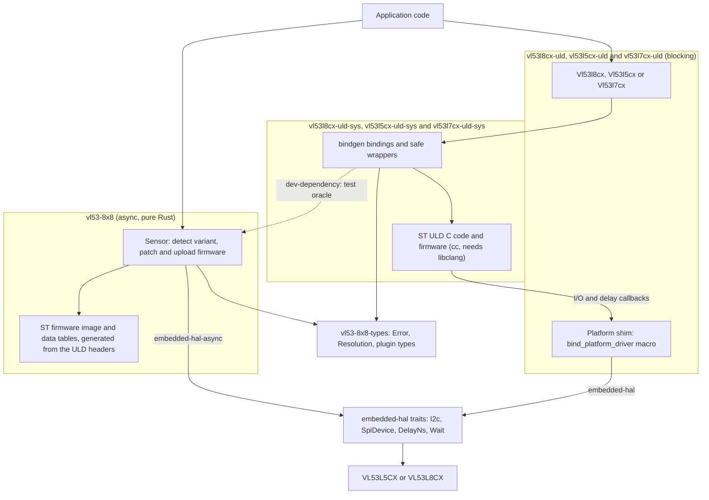

# VL53L5CX / VL53L8CX drivers for Rust

[](LICENSE)
[](https://crates.io/crates/vl53-8x8)
[](https://docs.rs/vl53-8x8)

Drivers for the **STMicroelectronics VL53L5CX, VL53L7CX and VL53L8CX**, the
8×8 multizone Time-of-Flight ranging sensors, written against `embedded-hal`
1.0 so they run on any microcontroller HAL or on Linux.

## What is this?

The VL53L5CX and VL53L8CX return a 4×4 or 8×8 grid of distances, up to four
targets per zone, at up to 60 Hz. ST supports them with a C library, the
*Ultra Lite Driver* (ULD), that uploads an 86 KB firmware image to the sensor
and then drives it through a register protocol. This repository provides two
ways to use that from Rust:

- **`vl53-8x8`** is a pure-Rust, `no_std`, async driver covering **all
  three** sensors (the VL53L7CX is the VL53L5CX die behind a wider lens). It
  needs no C toolchain. At `init()` it reads the chip's revision id, picks
  the VL53L5CX or VL53L8CX behaviour, uploads one shared firmware image
  patched for the detected part (the two images differ by only seven bytes),
  and then asks the running firmware whether an L5-class module is an L5 or
  an L7. It works with `embedded-hal-async` buses, with blocking buses
  through small adapters, and under Embassy, RTIC 2 or no executor at all.
- **`vl53l8cx-uld`**, **`vl53l5cx-uld`** and **`vl53l7cx-uld`** are blocking,
  safe wrappers over ST's own C code, one per sensor, each tracking ST's
  package for that part. They need libclang at build time (for `bindgen`)
  and exist for people who want ST's reference implementation behind an
  `embedded-hal` interface.

Both share one set of types (`vl53-8x8-types`), so `Error`, `Resolution`,
threshold and motion-indicator types are the same whichever driver you use.

### Which crate do I want?

| You want…                                              | Use                                   |
| ------------------------------------------------------ | ------------------------------------- |
| An async or blocking driver with no C, any of the three | [`vl53-8x8`](./vl53-8x8)              |
| ST's reference C driver behind a Rust API, VL53L8CX    | [`vl53l8cx-uld`](./vl53l8cx-uld)      |
| ST's reference C driver behind a Rust API, VL53L5CX    | [`vl53l5cx-uld`](./vl53l5cx-uld)      |
| ST's reference C driver behind a Rust API, VL53L7CX    | [`vl53l7cx-uld`](./vl53l7cx-uld)      |
| Just the shared types, e.g. to pass results around     | [`vl53-8x8-types`](./vl53-8x8-types)  |

## Supported platforms

Both drivers take any type implementing the relevant `embedded-hal` 1.0 trait
(`I2c`, `SpiDevice`, `OutputPin`, `DelayNs`, and `Wait` for the optional
interrupt pin), so they are not tied to a vendor HAL. The following have been
run against real hardware and are exercised by on-target test suites in
[`examples/`](./examples):

| Board                                   | Sensor            | Bus          | Driver          | Framework                     |
| --------------------------------------- | ----------------- | ------------ | --------------- | ----------------------------- |
| STM32F401RE Nucleo + X-NUCLEO-53L8A1    | VL53L8CX          | I²C and SPI  | `vl53-8x8`      | Embassy (async DMA)           |
| STM32F401RE Nucleo + X-NUCLEO-53L8A1    | VL53L8CX          | I²C and SPI  | `vl53l8cx-uld`  | `stm32f4xx-hal` (blocking)    |
| STM32F401RE Nucleo + X-NUCLEO-53L8A1    | VL53L8CX          | SPI          | `vl53-8x8`      | RTIC 2 + `stm32f4xx-hal`      |
| Custom STM32F412RE test PCB             | VL53L5CX, VL53L8CX| I²C          | `vl53-8x8`      | Embassy (async DMA)           |
| Custom STM32F412RE test PCB             | VL53L5CX          | I²C          | `vl53l5cx-uld`  | `stm32f4xx-hal` (blocking)    |
| Raspberry Pi Zero 2W + Pololu breakout  | VL53L8CX          | SPI          | both            | Linux, `linux-embedded-hal`, Tokio |

Other `embedded-hal` 1.0 implementations should work; only the targets above
have been validated end to end.

## How do I use it?

Add the driver you want to `Cargo.toml`:

```toml
[dependencies]
vl53-8x8 = "0.2"            # pure Rust, async, L5CX + L8CX
# or
vl53l8cx-uld = "0.2"        # blocking wrapper over ST's VL53L8CX ULD (needs libclang)
```

Both drivers follow the same shape: construct from a bus and a delay,
optionally attach the LPn line (`with_lpn_pin`: the sensor's I2C comms enable,
needed for multi-sensor address assignment, not a reset), the INT pin and a
power-enable line (`with_power_enable_pin_active_high/low`: `power_cycle()` is
the sensor's only real reset), call `init()` to upload the firmware, then
configure and range. Every call returns `Result<_, Error<BusError>>`.

### Async, pure Rust (`vl53-8x8`)

```rust,ignore
use vl53_8x8::{Resolution, Sensor};

let mut sensor = Sensor::new(i2c, delay)            // or Sensor::new_spi(spi_device, delay)
    .with_lpn_pin(lpn)                               // optional: LPn, I2C comms enable (active low)
    .with_power_enable_pin_active_high(pwr_en);      // optional: PWR_EN, enables power_cycle()
sensor.power_cycle().await?;                         // optional real reset (UM2884 §4.2); init() reboots anyway
sensor.init().await?;                                // detects L5CX vs L8CX, uploads patched firmware
defmt::info!("variant: {:?}", sensor.variant());

sensor.set_resolution(Resolution::Res4x4).await?;
sensor.set_ranging_frequency_hz(10).await?;
sensor.start_ranging().await?;
loop {
    sensor.poll_data_ready().await?;                 // or wait_for_data_ready() with an INT pin
    let frame = sensor.get_ranging_data().await?;
    // frame.distance_mm[zone * NB_TARGET_PER_ZONE + target], 8x8 layout regardless of resolution
}
```

On a blocking HAL, wrap the bus in `BlockingI2c` or `BlockingSpi` and drive
each call with a trivial `block_on`; the RTIC example shows this.

### Blocking, ST ULD (`vl53l8cx-uld`, `vl53l5cx-uld`, `vl53l7cx-uld`)

```rust,ignore
use vl53l8cx_uld::{Resolution, Vl53l8cx};

vl53l8cx_uld::bind_platform_driver!(MyI2c, MyDelay); // once per binary; `_spi!` variant for SPI

let mut sensor = Vl53l8cx::new(i2c, delay)           // or Vl53l8cx::new_spi(spi_device, delay)
    .with_lpn_pin(lpn)                               // optional
    .with_interrupt_pin_active_low(int)              // optional
    .with_power_enable_pin_active_high(pwr_en);      // optional
sensor.power_cycle()?;                               // optional real reset; init() reboots anyway
sensor.init()?;

sensor.set_resolution(Resolution::Res4x4)?;
sensor.set_ranging_frequency_hz(10)?;
sensor.start_ranging()?;
loop {
    if sensor.check_data_ready()? {
        let frame = sensor.get_ranging_data()?;
    }
}
```

Each crate's README has its full feature table and API notes; the example
crates show complete board bring-up sequences, including power and reset
timing.

### Cargo features

The drivers accept the same feature flags, forwarded to `vl53-8x8-types` and,
for the ULD wrappers, to the C build:

| Feature        | Effect                                                                 |
| -------------- | ---------------------------------------------------------------------- |
| `xtalk`        | Crosstalk calibration and cover-glass workflows.                       |
| `motion`       | Motion indicator plugin.                                               |
| `thresholds`   | Per-zone detection thresholds (and, on the L8, auto-stop).             |
| `raw-format`   | Return the sensor's fixed-point units instead of mm / kcps / %.        |
| `disable-*`    | Drop optional output fields to shrink `ResultsData` at build time.     |
| `targets-2..4` | Targets per zone (exactly one may be enabled; default is one).         |
| `defmt`        | Bus trace logging through `defmt`.                                     |

### How much flash and RAM does it need?

Measured on `vl53-8x8` in a release build for Cortex-M4 (the ULD wrappers
carry the same firmware image plus ST's C code):

| | Default features | With `motion` | All plugins + `targets-4` |
| --- | --- | --- | --- |
| Flash: ST firmware image | 86,016 B | 86,016 B | 86,016 B |
| Flash: data tables | ~1.8 KB | ~1.8 KB | ~2.8 KB (`xtalk` adds its command table) |
| Flash: driver code | ~6–7 KB | ~7 KB | ~7 KB |
| RAM: sensor state, inside `Sensor` | 2,580 B | 2,724 B | 4,644 B |
| RAM: one `ResultsData` frame | 1,220 B | 1,360 B | 3,280 B |

The firmware image dominates and is unavoidable: the sensor has no
non-volatile store and needs it uploaded after every power-up. Everything
else fits comfortably on parts with 64 KB of RAM; the on-target test suites
run on an STM32F401RE with 96 KB. Run
`cargo test -p vl53-8x8 -- --ignored --nocapture print_footprint` with your
feature set to get exact numbers.

## Has it been tested on real hardware?

Yes. Three layers of testing back the drivers:

- **On-target test suites.** Every example crate carries an `embedded-test`
  suite that runs on the board over probe-rs: firmware upload, every
  configuration getter and setter, 4×4 and 8×8 ranging, the plugins, power
  modes, multi-target scenes, crosstalk calibration with ST's cover-glass
  sample, and motion detection. The `justfile` encodes the full matrix
  (`just --list`).
- **Byte-level comparison with ST's code.** The pure-Rust driver was ported
  line by line from ST's ULD, and [`differential-tests/`](./differential-tests)
  proves it: bus traffic recorded from the real sensor is replayed on the host
  to both ST's C code and the Rust driver, and their register transcripts are
  compared byte for byte. Every recorded sequence matches apart from two
  documented, deliberate differences. This comparison found and fixed a bug in
  the C wrapper along the way.
- **Oracle tests.** The firmware image, the configuration tables and the
  seven-byte and five-byte patches that turn the VL53L8CX data into the
  VL53L5CX data are checked against ST's own arrays on every `cargo test`.

**A note on authorship.** Most of the Rust in this repository was written by
an AI assistant (Claude) under human direction and review, starting from Scott
Wakefield's earlier `vl53l5cx-driver` work. That is why the verification
story above matters: the drivers were not trusted because of who wrote them,
but because their bus traffic was compared against ST's reference
implementation and because they were run, repeatedly, on the hardware listed
above. Bug reports are welcome; the test harnesses make them easy to
reproduce.

## Crates

| Crate / directory          | Role                                                                    |
| -------------------------- | ----------------------------------------------------------------------- |
| [`vl53-8x8-types`](./vl53-8x8-types) | Shared enums, `Error`, plugin types. `no_std`, zero dependencies.       |
| [`vl53-8x8`](./vl53-8x8)             | Pure-Rust async driver for VL53L5CX, VL53L7CX + VL53L8CX (`embedded-hal-async`, blocking adapters). |
| [`vl53l8cx-uld-sys`](./vl53l8cx-uld-sys) | bindgen + `cc` over ST's VL53L8CX ULD C sources and firmware.          |
| [`vl53l8cx-uld`](./vl53l8cx-uld)     | Safe blocking `embedded-hal` wrapper over `vl53l8cx-uld-sys`.           |
| [`vl53l5cx-uld-sys`](./vl53l5cx-uld-sys) | bindgen + `cc` over ST's VL53L5CX ULD C sources and firmware.          |
| [`vl53l5cx-uld`](./vl53l5cx-uld)     | Safe blocking `embedded-hal` wrapper over `vl53l5cx-uld-sys`.           |
| [`vl53l7cx-uld-sys`](./vl53l7cx-uld-sys) | bindgen + `cc` over ST's VL53L7CX ULD C sources and firmware.          |
| [`vl53l7cx-uld`](./vl53l7cx-uld)     | Safe blocking `embedded-hal` wrapper over `vl53l7cx-uld-sys`.           |
| [`differential-tests`](./differential-tests) | Not published. Host-side replay of recorded sensor traffic to both drivers; see above. |

### Examples

| Directory | What it shows |
| --------- | ------------- |
| [`examples/nucleo-f401re-uld/`](./examples/nucleo-f401re-uld) | `vl53l8cx-uld` on an STM32F401RE Nucleo + X-NUCLEO-53L8A1, I²C or SPI (`spi-bus`). |
| [`examples/nucleo-f401re-embassy/`](./examples/nucleo-f401re-embassy) | `vl53-8x8` on the same board under Embassy, true async DMA I²C or SPI. |
| [`examples/nucleo-f401re-rtic/`](./examples/nucleo-f401re-rtic) | `vl53-8x8` on the same board under RTIC 2 with the blocking `stm32f4xx-hal` via the `BlockingI2c` / `BlockingSpi` adapters. |
| [`examples/evo-f412re-embassy/`](./examples/evo-f412re-embassy) | `vl53-8x8` under Embassy on the maintainers' custom STM32F412RE test PCB (see its README): DMA I²C, L5 or L8, two sensors on one bus. |
| [`examples/evo-f412re-uld/`](./examples/evo-f412re-uld) | `vl53l5cx-uld` on the same test PCB, I²C. |
| [`examples/rpi-zero-2w/`](./examples/rpi-zero-2w) | Both drivers on Linux (Raspberry Pi Zero 2W), SPI via `linux-embedded-hal`. |

`examples/` holds standalone board crates: each is its own cargo root with its
own target, HAL and linker configuration, is excluded from the workspace, and
is `publish = false`, so each is built (and its on-target tests run) from its
own directory.

## Architecture



* **Platform-agnostic via embedded-hal.** Both drivers take any type
  implementing the relevant `embedded-hal` 1.0 trait. The blocking drivers
  reach the bus from C through the `bind_platform_driver!` /
  `bind_platform_driver_spi!` macros, invoked once per binary.
* **libclang is only needed for the ULD crates.** The `-uld-sys` crates run
  `bindgen` at build time (set `LIBCLANG_PATH` if it is not found). `vl53-8x8`
  has no build script and no C; it uses the sys crates only as dev-dependencies,
  so its oracle tests (`cargo test -p vl53-8x8`) need libclang but downstream
  builds do not.
* **One firmware, two parts.** `vl53-8x8` ships ST's VL53L8CX firmware image
  and tables (`tools/extract_uld_blobs.py` regenerates them from the ULD
  headers) and patches the handful of bytes that differ for the VL53L5CX at
  upload time, after reading the chip's revision id.

## Development

This workspace uses a Nix flake to pin the Rust toolchain, libclang, the
ARM bare-metal cross toolchain, the Pi cross toolchains, `probe-rs-tools`,
`cargo-binutils` and `just`.

```bash
nix develop                            # drop into the dev shell
cargo test --workspace                 # host tests incl. the C-oracle and differential tests
just --list                            # host + hardware recipes, grouped by target
just test-nucleo-embassy spi-bus       # flash + run an on-target suite (probe-rs)
```

Each example crate's README covers its own setup: board jumpers, kernel
options, udev rules and so on.

## License

This workspace is licensed under the **BSD 3-Clause License**; see
[`LICENSE`](LICENSE).

The C source under [`vl53l8cx-uld-sys/src/VL53L8CX_ULD_API/`](./vl53l8cx-uld-sys/src/VL53L8CX_ULD_API),
[`vl53l5cx-uld-sys/src/VL53L5CX_ULD_API/`](./vl53l5cx-uld-sys/src/VL53L5CX_ULD_API)
and [`vl53l7cx-uld-sys/src/VL53L7CX_ULD_API/`](./vl53l7cx-uld-sys/src/VL53L7CX_ULD_API),
and the firmware image and data tables shipped in `vl53-8x8`, are the
official **STMicroelectronics Ultra Lite Drivers**, distributed by ST under
the BSD 3-Clause License (see the `LICENSE-ST` files, the per-file copyright
headers and `LICENSE.txt` in ST's
[STSW-IMG040](https://www.st.com/en/embedded-software/stsw-img040.html) and
[STSW-IMG023](https://www.st.com/en/embedded-software/stsw-img023.html)
packages). The C code is included verbatim apart from line-ending
normalisation and a single missing-semicolon fix in `vl53l8cx_api.c`.

The Rust portions originate from Scott Wakefield's earlier
`vl53l5cx-driver` / `vl53l8cx-driver` work and are included here under
BSD 3-Clause with the original author's permission.
