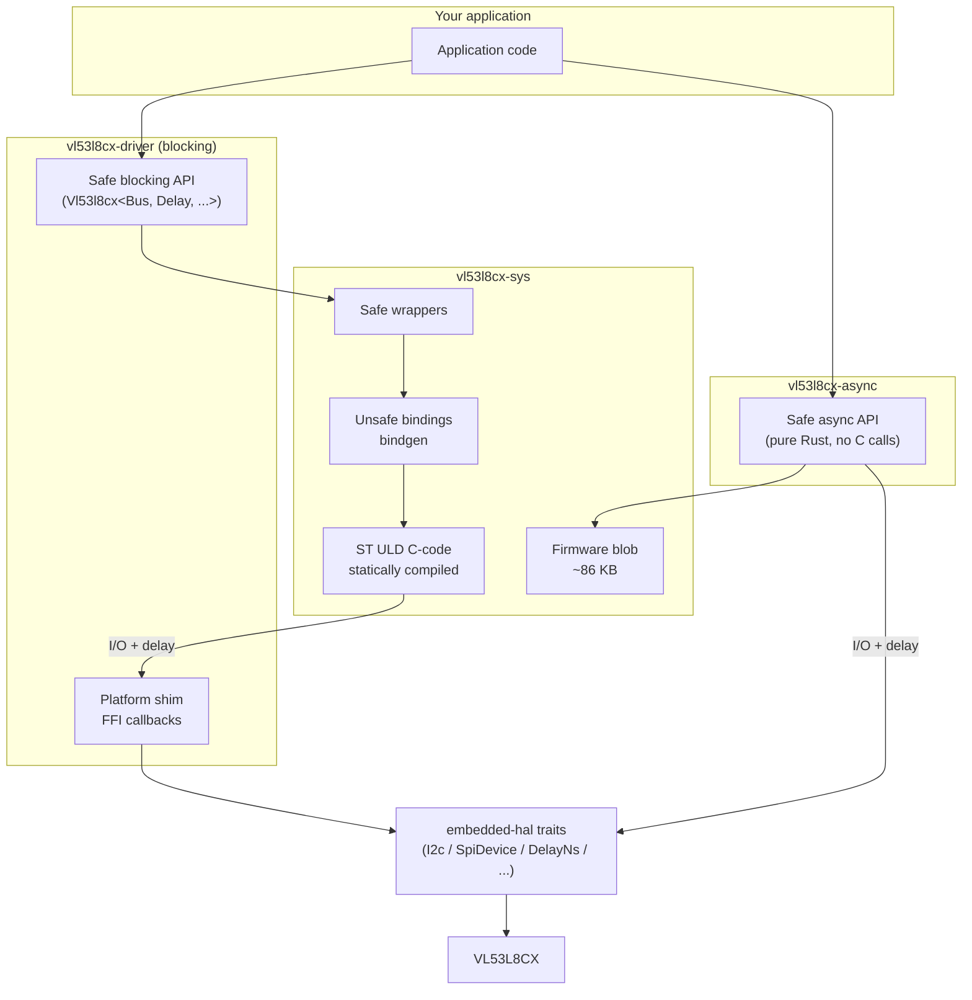

# VL53L8CX Driver (Rust)

[](LICENSE-MIT)
[](https://marketplace.visualstudio.com/items?itemName=bierner.markdown-mermaid)

A platform-agnostic Rust driver for the **STMicroelectronics VL53L8CX**
Time-of-Flight (ToF) 8×8 multi-zone ranging sensor.

The workspace contains two driver crates plus three example/demo crates:

| Crate                    | Role                                                                 |
| ------------------------ | -------------------------------------------------------------------- |
| `vl53l8cx-sys`           | Low-level FFI bindings + statically-linked ST ULD C source.          |
| `vl53l8cx-driver`        | Safe blocking API on top of the C ULD; uses `embedded-hal` 1.0.      |
| `vl53l8cx-async`         | Pure-Rust async port (no C runtime); uses `embedded-hal-async` 1.0.  |
| `nucleo-f401re/`         | Bare-metal blocking demo on STM32F401RE Nucleo, I²C or SPI bus.      |
| `nucleo-f401re-async/`   | Bare-metal async (Embassy) demo on STM32F401RE, I²C or SPI bus.      |
| `rpi-zero-2w/`           | Linux demo on a Raspberry Pi Zero 2W, SPI via `linux-embedded-hal`.  |

## Verified platforms

These are the configurations actively built and run against real hardware
in this repository:

* **Bare-metal Cortex-M4** — STM32F401RE Nucleo board with the
  X-NUCLEO-53L8A1 expansion shield, both I²C and SPI, both blocking
  (`stm32f4xx-hal`) and async (`embassy-stm32`) execution. See
  [`nucleo-f401re/`](./nucleo-f401re) and [`nucleo-f401re-async/`](./nucleo-f401re-async).
* **Linux on Raspberry Pi Zero 2W** — Pololu VL53L8CX breakout over
  `/dev/spidev0.0` and `/dev/gpiochip0` via `linux-embedded-hal`, both
  blocking and async (Tokio current-thread). See
  [`rpi-zero-2w/`](./rpi-zero-2w).

Other `embedded-hal` 1.0 implementations should work — both driver crates
are written against generic `I2c` / `SpiDevice` / `OutputPin` / `DelayNs`
traits — but only the targets above have been validated end-to-end.

## Usage

The driver is constructed from an `embedded-hal` bus and delay, optionally
a reset pin (LPn) and interrupt pin (data ready), then `init()` uploads the
firmware. Either `new` (I²C) or `new_spi` (SPI) gives a typed handle:

```rust
use vl53l8cx_driver::{Vl53l8cx, Resolution};

// I²C
let mut sensor = Vl53l8cx::new(i2c, delay)
    .with_reset_pin_active_low(lpn)
    .with_interrupt_pin_active_low(int);
sensor.reset()?;
sensor.init()?;          // ← uploads ~86 KB firmware blob to the chip

// or SPI (Mode 3, MSB-first)
let mut sensor = Vl53l8cx::new_spi(spi, delay)
    .with_reset_pin_active_low(lpn);
sensor.reset()?;
sensor.init()?;

sensor.set_resolution(Resolution::Res4x4)?;
sensor.set_ranging_frequency_hz(10)?;
sensor.start_ranging()?;

loop {
    if sensor.check_data_ready()? {
        let data = sensor.get_ranging_data()?;
        // data.distance_mm is [i16; 64] (8×8 layout regardless of resolution)
    }
}
```

The async crate (`vl53l8cx-async`) has the same shape with `.await` on
each call.

For runnable end-to-end examples see the demo crates listed above; each
has its own README covering wiring, host setup, and build/run steps.

## Cargo features

Both `vl53l8cx-driver` and `vl53l8cx-async` accept the same feature flags
to opt in to ULD plugins or out of unused result fields, trading flash
and RAM:

| Feature        | Effect                                                          |
| -------------- | --------------------------------------------------------------- |
| `xtalk`        | Crosstalk calibration support (cover-glass workflows).          |
| `motion`       | Motion indicator plugin.                                        |
| `thresholds`   | Per-zone detection thresholds for interrupt triggers.           |
| `targets-1..4` | Number of targets tracked per zone (default `targets-1`). Pick **exactly one**. |
| `disable-*`    | Drop optional output fields (`ambient`, `signal`, `reflectance`, `nb-spads`, etc.) to shrink `ResultsData` at build time. |
| `std`          | Adds `std::error::Error` / `Display` impls on `Error`.          |

## API reference (selected)

All driver methods return `Result<T, Error<BusError>>`. The full set lives
in [`vl53l8cx-driver/src/lib.rs`](./vl53l8cx-driver/src/lib.rs) — a
condensed view of the most-used calls:

### Construction & control

| Method                            | Description |
| --------------------------------- | ----------- |
| `new(i2c, delay)`                 | I²C constructor; doesn't talk to the chip. |
| `new_spi(spi, delay)`             | SPI constructor (Mode 3). |
| `with_reset_pin_active_low/high`  | Builder: attach an LPn `OutputPin`. |
| `with_interrupt_pin_active_low/high` | Builder: attach a data-ready `InputPin`. |
| `reset()`                         | Pulse LPn (requires reset pin). |
| `init()`                          | `is_alive` probe + firmware upload (~86 KB). |
| `is_alive()`                      | Read chip ID; `true` if it matches `0xF0`/`0x0C`. |
| `set_i2c_address(addr)`           | Change runtime I²C address (volatile). |

### Ranging configuration

| Method                            | Description |
| --------------------------------- | ----------- |
| `set_resolution(Res4x4 / Res8x8)` | Output grid (4×4 max 60 Hz, 8×8 max 15 Hz). |
| `set_ranging_frequency_hz(u8)`    | Frame rate. |
| `set_ranging_mode(Continuous / Autonomous)` | Continuous = back-to-back, Autonomous = lower power. |
| `set_integration_time_ms(u32)`    | Exposure (2–1000 ms, Autonomous mode only). |
| `set_target_order(Closest / Strongest)` | Multi-target ordering. |
| `set_sharpener_percent(u8)`       | Edge-sharpener filter, 0–99 %. |
| `set_power_mode(...)` / `get_power_mode()` | `Wakeup` / `Sleep` / `DeepSleep`. |
| `set_vhv_repeat_count(u32)`       | Temperature recalibration interval. |

### Ranging loop

| Method                            | Description |
| --------------------------------- | ----------- |
| `start_ranging()` / `stop_ranging()` | Begin / end measurement session. |
| `check_data_ready()`              | Poll-based ready flag (true when a new frame is queued). |
| `wait_for_data_ready_blocking()`  | Tight-poll the interrupt pin (blocking driver, requires INT). |
| `wait_for_data_ready().await`     | Async equivalent (async driver, requires `Wait`-implementing INT). |
| `get_ranging_data()`              | Read the latest `ResultsData` block. |

The optional `motion`, `thresholds`, and `xtalk` features each unlock an
additional set of methods — see the relevant `examples/` files in
`vl53l8cx-driver/`.

## Architecture

`vl53l8cx-driver` is a **Foreign Function Interface (FFI) wrapper** around
the official STMicroelectronics Ultra Lite Driver (ULD): the ranging
algorithms, register-level state machines, and firmware blob all come
from ST's own C code, statically compiled into the `vl53l8cx-sys` crate.

`vl53l8cx-async` is an independent pure-Rust port of the I/O paths, with
no C runtime calls — it shares only types and the firmware blob from
`vl53l8cx-sys`.



### Key concepts

* **Platform-agnostic via embedded-hal.** Both crates take any type
  implementing the relevant `embedded-hal` 1.0 trait — `I2c`,
  `SpiDevice`, `OutputPin`, `InputPin`, `DelayNs`. The blocking driver
  exposes its FFI callbacks through the `bind_platform_driver!` /
  `bind_platform_driver_spi!` macros, which the demo crates invoke once
  per binary.
* **Static linking.** `vl53l8cx-sys` builds the ST ULD with `cc` and
  generates Rust bindings with `bindgen`; the firmware blob is a static
  byte array linked into the final binary.

## Development

This workspace uses a Nix flake to pin the Rust toolchain, the
ARM-bare-metal cross-toolchain (`gcc-arm-embedded`), the Pi cross
toolchains (`pkgsCross.aarch64-multiplatform{,-musl}`,
`pkgsCross.armv7l-hf-multiplatform`), and `probe-rs-tools` /
`cargo-binutils` for flashing the Nucleo board.

```bash
nix develop                       # drop into the dev shell
cargo build --workspace           # build the three driver crates
cd nucleo-f401re && cargo run     # flash + run on a connected Nucleo
cd rpi-zero-2w && cargo build --target aarch64-unknown-linux-musl --bins
```

Each demo crate's README covers its own setup (board jumpers, kernel
options, udev rules, etc.).

### Viewing the architecture diagram

The diagram above uses Mermaid. VS Code's markdown preview supports it
with the **Markdown Preview Mermaid Support** extension; GitHub renders
it natively.

## License

### Rust wrapper code

Dual-licensed under your choice of:
* **MIT License** ([LICENSE-MIT](LICENSE-MIT) or
  <http://opensource.org/licenses/MIT>)
* **Apache License, Version 2.0** ([LICENSE-APACHE](LICENSE-APACHE) or
  <http://www.apache.org/licenses/LICENSE-2.0>)

### STMicroelectronics driver code

`vl53l8cx-sys` statically links and redistributes the
**STMicroelectronics VL53L8CX Ultra Lite Driver**, which is included in
the source tree.

**The STMicroelectronics ULD software is subject to the proprietary
STMicroelectronics license terms (SLA0044).**

> Use of the underlying C driver is restricted to use with **STMicroelectronics
> products** (specifically the VL53L8CX sensor). By using this crate you
> agree to the terms in `LICENSE-ST` shipped with this repository.
